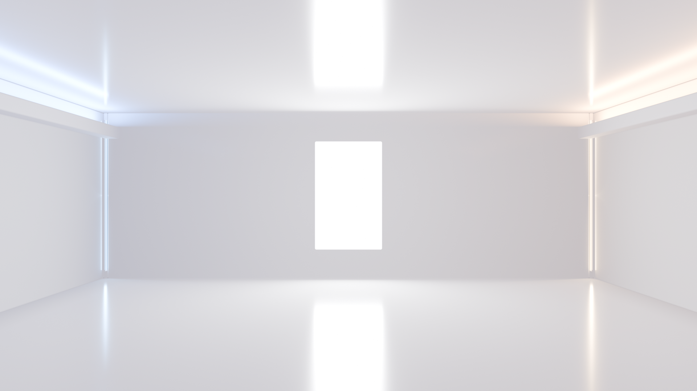
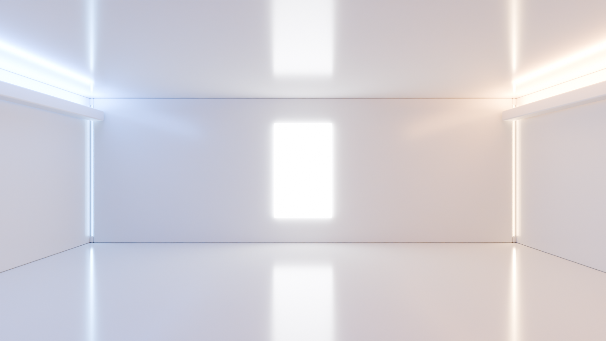

# LIGHT LAB

같은 갤러리에서 **Eevee의 래스터화·조명 근사**와 **Cycles의 패스 트레이싱**을 비교하는 로컬 교육용 실험 앱입니다. CS 전공자가 직접광, 간접광, 반사와 계산 비용의 관계를 관찰하도록 만들었습니다.

| Eevee | Cycles |
|---|---|
|  |  |

## 주요 기능

- 중앙 패널, 좌우 코브, 좌우 모서리: 5개 광원의 색상·세기·ON/OFF 독립 제어
- 480×360 / 960×540 / 1920×1080, 32·64·128·256·512 samples 선택
- 두 엔진의 결과·실측 시간·겹쳐 보기, 10~400% 확대와 전체 화면
- 직렬 렌더 대기열, 취소, 기록·캐시, 설정 JSON 가져오기/내보내기
- 결과 ZIP·측정 CSV, 준비 1회 + 본측정 3회의 반복 측정 기능

## 빠른 시작

검증 기준은 **macOS Apple Silicon, Blender 4.5.15 LTS, Metal**입니다. Python 3.11 이상과 Node.js 22.12 이상, Blender 4.5 LTS를 준비하세요. 다른 OS의 실제 GPU 렌더는 검증하지 않았습니다.

```bash
git clone https://github.com/skybluesoda/light-lab.git
cd light-lab
cd app/frontend
npm install
npm run build
cd ../..
BLENDER_BIN='/Applications/Blender.app/Contents/MacOS/Blender' ./start_app.sh
```

`http://127.0.0.1:8765`를 엽니다. 첫 실행은 `app/.venv`와 Python 의존성을 준비합니다. 포트 변경은 `LIGHT_LAB_PORT=8766`, Python 지정은 `PYTHON_BIN=/path/to/python3`을 사용합니다. pnpm 사용자는 포함된 lockfile로 `pnpm install --frozen-lockfile && pnpm build`를 실행할 수 있습니다.

**일반 macOS 터미널에서 실행하세요.** 실행 세션에서 Metal 접근이 불가능하면 GPU 사전 점검이 새 렌더를 차단합니다. 점검을 우회하지 않습니다. 이미지·보고서는 `app/data/`에 생성되며 Git에는 포함하지 않습니다.

## 두 렌더의 차이

| 항목 | 현재 Eevee | 현재 Cycles |
|---|---|---|
| 가시 표면 | 래스터화 | 카메라 광선과 표면 교차 |
| 직접광 | Area Light, 패널 보조 광원 | 원래 광원·발광 재질 |
| 확산 간접광 | 광원 색·세기·거리 기반의 비물리적 필드 | 경로 샘플링 |
| 광택 반사 | Sphere Probe + Box Parallax | 표면의 광택 산란 경로 |
| 선택 기능 | Raytracing / Fast GI OFF, 라이트맵 없음 | 적응형 샘플 OFF, denoise ON |

같은 샘플 수는 같은 화질이나 연산량을 뜻하지 않습니다. Eevee용 필드와 패널 프록시는 Cycles에 적용하지 않습니다. 따라서 장면·요청 값을 공유하는 **서로 다른 조명 표현의 비교**입니다.

## 실제 측정 예시

FHD, 공통 256 samples, Apple M2 8-core GPU / Metal, Blender 4.5.15 LTS. 2026-10-29 저장 작업의 단일 기록입니다.

| Eevee | Cycles | 전체 작업 |
|---:|---:|---:|
| 14.274 s | 273.714 s | 289.283 s |

이미지와 엔진 보고서: [docs/images](docs/images). 엔진별 값은 렌더 호출 전후이며 초기화·PNG 저장을 포함합니다. 일반적인 속도 배율, 동일 화질 성능, 실제 GPU 반복 통계로 해석하지 않습니다.

## 개발과 검증

```bash
python3 -m venv app/.venv
app/.venv/bin/python -m pip install -r app/backend/requirements-dev.txt
app/.venv/bin/python -m pytest tests app/backend/tests -q
```

Blender 없이 실행하는 API·대기열·설정·근사 수식 테스트입니다. 합성 테스트 결과를 실제 렌더로 표시하지 않습니다. 렌더 회귀 검증은 Blender·GPU가 있는 환경에서 별도로 수행해야 합니다.

## 문서와 구조

- [실행·사용 방법](docs/USAGE.md)
- [렌더링 기법과 한계](docs/RENDERING.md)
- [개발 과정](docs/DEVELOPMENT.md)
- [검증 기록](docs/VALIDATION.md)
- [자료 출처·배포 범위](docs/ASSETS.md)
- `app/frontend/`: React + Vite, `app/backend/`: FastAPI와 렌더 실행기
- `scene_approx.py`, `approx_lighting.py`: 현재 장면·간접광 근사
- `scene.py`, `lightmaps.py`, `preset_lab.py`: 이전 라이트맵·프리셋 실험과 공유 유틸리티
- `config/`, `tests/`: 입력 예제와 자동 검증

과거 단계의 문서는 `docs/archive/`에 보존했습니다. 과거의 실행법·검증 대기 표시는 당시 상태이며 현재 실행의 기준은 이 README입니다. 공개 배포, 바운스 UI, 실제 광선 경로 시각화는 아직 구현하지 않았습니다.
